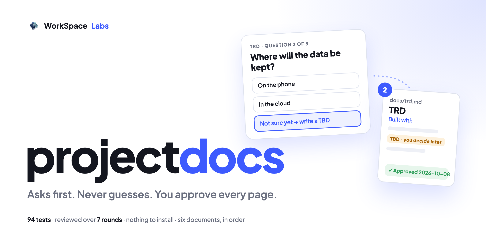

# project-docs



**The documents your project needs, written with you before anyone builds it.**

An agent skill that asks about your project in small click rounds, reads it back in plain words, and writes
six documents in order. The AI **never picks the technology by itself**: you choose, or it is written down
as an honest "TBD". Each document is approved with a date, and after that every AI on every computer
builds from the same truth.

The skill is the folder [`skills/project-docs/`](skills/project-docs/): its instructions,
[`SKILL.md`](skills/project-docs/SKILL.md), one reference file per document, and a preview page for picking
the look. **Nothing to install.**

**Version 0.1.2** · 101 tests · tested on Windows, Chrome and Edge · [how it was tested](TESTING.md)

---

## What you get

In your project:

| File | What it is | When |
|---|---|---|
| `docs/prd.md` | **PRD**: what it is, why, who it's for, what it must do, what it will NOT do, how we know it worked | always |
| `docs/trd.md` | **TRD**: what it is built with, the rules it follows, how the code is written, and why each choice | always |
| `DESIGN.md` | **The look**: colors, fonts, shapes, pieces, must-have rules and ready values every AI copies | when it has screens |
| `docs/data.md` | **Data**: every table and column, with personal 🔒 and secret 🔐 data marked | when it saves anything |
| `docs/security.md` | **Security**: who gets in, secrets, personal data, outside services, what to do if something goes wrong | always (short when simple) |
| `docs/plan.md` | **The plan**: small steps you can see work, each with its check | always |

Each document carries a stamp under its title: `> v1 · Draft`, then `> v2 · Approved 2026-10-08`.

## How it works

1. **It reads what you already have** and continues from the first document that isn't approved. In a
   project that already has code, it writes what it finds as "found in code" and asks only about the gaps.
2. **It asks 2 or 3 questions a round**, with click choices and its recommended pick, never a wall of
   questions. Later documents reuse earlier answers: it never asks twice.
3. **It reads it back** and writes nothing until you say "yes, that's it".
4. **You (or your client) approve**, or ask for changes: each round of changes is a new version.
5. **Locked choices stay visible.** A technology or color that changes keeps its old line, with a dated
   "Changed: X → Y, because …" under it.
6. **The look is picked by eye**: a preview page shows 2 or 3 looks side by side, filled with your project's
   own words. Every look has passed a readability check before you see it.
7. **The plan is ticked by you.** The AI marks a step "waiting for your check" with what it ran; only you
   mark it checked.

English by default; **Arabic** turns every document, and the preview, right to left.

If the [frameflow](https://github.com/workspace-labs/frameflow) skill is installed, project-docs offers it
once between the TRD and the look, to draw the app's screens as a storyboard.

## Install

The skill needs nothing but your AI tool. The preview page needs only a browser.

**Claude Code, Codex and other agents**, in one line:

```bash
npx skills add workspace-labs/project-docs -g
```

Or by hand, for Claude Code on macOS or Linux:

```bash
git clone https://github.com/workspace-labs/project-docs.git
mkdir -p ~/.claude/skills
cp -R project-docs/skills/project-docs ~/.claude/skills/
```

On Windows, use PowerShell (choose your agent's destination):

```powershell
git clone https://github.com/workspace-labs/project-docs.git
# Claude Code:
$skillsDir = Join-Path $env:USERPROFILE '.claude\skills'
# For Codex, use this destination instead:
# $skillsDir = Join-Path $env:USERPROFILE '.codex\skills'
New-Item -ItemType Directory -Path $skillsDir -Force | Out-Null
Copy-Item -LiteralPath '.\project-docs\skills\project-docs' -Destination $skillsDir -Recurse
```

**Claude app (chat and Cowork)**: make the zip, then upload it in **Customize → Skills**.

On macOS or Linux:

```bash
cd project-docs
rm -f dist/project-docs.zip && mkdir -p dist
(cd skills && zip -r -X ../dist/project-docs.zip project-docs -x '*.DS_Store')
```

On Windows, in PowerShell:

```powershell
Set-Location project-docs
New-Item -ItemType Directory -Path '.\dist' -Force | Out-Null
Compress-Archive -LiteralPath '.\skills\project-docs' -DestinationPath '.\dist\project-docs.zip' -Force
```

**GitHub Copilot, Cursor and ChatGPT**: where your tool supports agent skills, install the same folder.

Then start a fresh session and say what you want to build: "Let's write the project docs for my bakery
website before we build it."

## See an example

[`skills/project-docs/examples/cedar-clinic/`](skills/project-docs/examples/cedar-clinic/) holds all six
documents for a made-up clinic booking website, and
[`cedar-clinic-ar/`](skills/project-docs/examples/cedar-clinic-ar/) the same in Arabic.
[`study-timer/`](skills/project-docs/examples/study-timer/) shows a tiny offline tool: it saves nothing, so it
has no data document, and its security page is six short lines.

To see the look preview without an agent, copy
[`skills/project-docs/assets/preview/`](skills/project-docs/assets/preview/) somewhere, put an example's
`docs/design-preview/looks.js` next to `preview.html`, and open `preview.html` in a browser.

## How it was tested

The original 94 tests passed on Node.js 18, 20 and 22. Windows testing added regressions for line endings
and font coverage, plus offline Chrome and Edge checks of the English and Arabic previews. The earlier
release also caught 38 planted bugs, completed two blind dry runs, and passed 7 rounds of independent
review. The current test count, full record and remaining limits are in [`TESTING.md`](TESTING.md).

## Limits

- 2 or 3 looks in the preview; 6 fonts are inside it (Plus Jakarta Sans, Instrument Sans, Bricolage
  Grotesque, Lora, Crimson Pro, Noto Naskh Arabic). Another font is loaded online only when you say yes.
- English and Arabic.
- It writes documents, not code: the only code it writes is the ready values in `DESIGN.md` and the ready
  tables in `docs/data.md`.

## Working on project-docs

See [`AGENTS.md`](AGENTS.md). Tests: `node --test` (Node.js 18 or newer, for the tests only).

## Licence

MIT, see [`LICENSE`](LICENSE). The fonts keep their SIL Open Font License; see [`CREDITS.md`](CREDITS.md).
