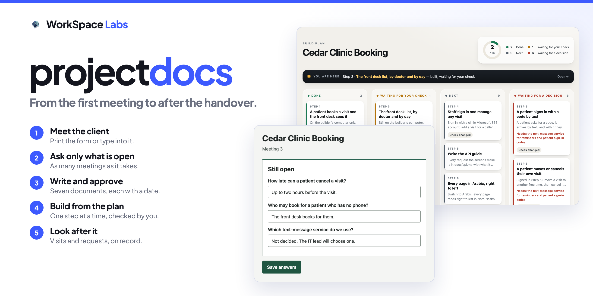

# project-docs



**Write your project documents before building and keep a maintenance record after handover.**

An agent skill that asks about your project in small click rounds, reads it back in plain words, and writes
seven planning documents in order, from the first client meeting to the handover. The AI **never picks the
technology by itself**: you choose, or it is written down as an honest "TBD". Each planning document is
approved with a date, and after that every AI on every computer builds from the same truth. After handover
the skill records visit dates, check results and client requests.

The skill is the folder [`skills/project-docs/`](skills/project-docs/): its instructions,
[`SKILL.md`](skills/project-docs/SKILL.md), one reference file per document, a preview page for picking
the look, and a small script that draws the plan page. **Nothing to install** to write or read the
documents, or to open the pages. Making or refreshing the plan page uses Node.js 18 or newer, which most
coding tools already have; without it the plan stays in `docs/plan.md`.

**Version 0.15.0** · 264 tests · scope, limits and earlier preview/platform results are recorded in [how it was tested](TESTING.md).

---

## What you get

In your project:

| File | What it is | When |
|---|---|---|
| `docs/prd.md` | **PRD**: what it is, why, who it's for, what it must do, what it will NOT do, how we know it worked | always |
| `docs/trd.md` | **TRD**: what it is built with, what its AI part may decide alone and what a person approves, what it costs to run and who pays, the rules it follows, how the code is written, where the code is kept, and why each choice | always |
| `DESIGN.md` | **The look**: colors, fonts, shapes, pieces, must-have rules and ready values every AI copies | when it has screens |
| `docs/data.md` | **Data**: every table and column, with personal 🔒 and secret 🔐 data marked | when it saves anything |
| `docs/security.md` | **Security**: who gets in, how it's protected, secrets, personal data, outside services, what to do if something goes wrong | always (short when simple) |
| `docs/handover.md` | **Handover**: what is handed over (and who owns the code), who receives it, how it is announced, the first weeks after go-live, who runs it and who pays for it from then on, the agreed maintenance rule, how it is retired | for a handover, or when needed for a solo owner's requested maintenance record |
| `docs/plan.md` | **The plan**: small steps you can see work, each with its check | always |
| `docs/plan.html` | **The plan page**: the plan as a board (Done · Waiting for your check · Next · Waiting for a decision) with "You are here"; every card opens to its plan, what was built and your decisions. Kept current after every step, opened when you ask "where are we?", and it works on a phone | always, made by a script (needs Node.js) |
| `docs/maintenance.md` | **Maintenance record** with the next light and full visit dates, the results reported by whoever ran the checks, and client requests | at handover or the first maintenance request, with an approved Handover |

For a new client project, you get the **client meeting form** first, as Markdown and an HTML page you can
print or type into and save. Discovery follows four stages over as many meetings as needed. After every
meeting, review what's clear, missing or conflicting, and take only open questions to the next meeting.
You decide when to draft the PRD. The scope decision has its own meeting after that draft. For a project
of your own, start with the PRD.

Each planning document carries a stamp under its title, starting with `> v1 · Draft` and showing a dated
approval such as `> v2 · Approved 2026-10-08`.

The same documents carry the detail a project actually needs: outside-service responses and failures
in the TRD; required/unique fields and removal rules in Data; brief threat scenarios, encrypted
connections and applicable audit records in Security. Existing Plan steps carry restore checks for
irreplaceable data, README instructions for another user, release/rollback checks when distributed,
and an owner-supplied notice before collecting personal data. A tiny offline tool keeps its short
None lines. These add no planning document or approval stage.

## How it works

1. **It reads what you already have** and continues from the first document that isn't approved. In a
   project that already has code, it writes what it finds as "found in code" and asks only about the gaps.
2. **It asks 2 or 3 questions a round**, with click choices and its recommended pick, never a wall of
   questions. Later documents reuse earlier answers: it never asks twice.
3. **It reads it back** and writes nothing until you say "yes, that's it".
4. **You (or your client) approve**, or ask for changes: each round of changes is a new version.
5. **Locked choices stay visible.** A technology or color that changes keeps its old line, with a dated
   "Changed: X → Y, because …" under it.
6. **The look is picked by eye**: a preview page shows 2 or 3 looks side by side, filled with your project's
   own words. Every look has passed a readability check before you see it.
7. **The plan is ticked by you.** The AI marks a step "waiting for your check" with what it ran; only you
   mark it checked.

English by default; **Arabic** turns every document, and the preview, right to left.

After you approve the Plan, the skill offers a short block for `AGENTS.md` or `CLAUDE.md` so Claude and
Codex can find the next step and read the approved documents it needs. The skill asks before editing either file.

If the [frameflow](https://github.com/workspace-labs/frameflow) skill is installed, project-docs offers it
once between the TRD and the look, to draw the app's screens as a storyboard.

## After the handover

Agree the light and full visit schedule, the serious security fix deadline and who gets each visit's
results with the client in the Handover. The separate maintenance record keeps dates and history
without an approval stamp. For a project of your own, ask for a record when you want one. It still needs
an approved Handover. When you open the project, the skill tells you if either visit is due soon
or late. It records the results from whoever ran the checks, updates the visit dates and gives you
the next date for your calendar. Only you mark a visit checked.

For a new client request, the skill refers to the approved PRD when it records a fault, a change or
routine upkeep. A change needs a new approved PRD version before building starts.

## Install

The skill needs nothing but your AI tool. The preview page needs only a browser.

**Claude Code, Codex and other agents**, in one line:

```bash
npx skills add workspace-labs/project-docs -g
```

Or by hand, for Claude Code on macOS or Linux:

```bash
git clone https://github.com/workspace-labs/project-docs.git
mkdir -p ~/.claude/skills
cp -R project-docs/skills/project-docs ~/.claude/skills/
```

On Windows, use PowerShell (choose your agent's destination):

```powershell
git clone https://github.com/workspace-labs/project-docs.git
# Claude Code:
$skillsDir = Join-Path $env:USERPROFILE '.claude\skills'
# For Codex, use this destination instead:
# $skillsDir = Join-Path $env:USERPROFILE '.codex\skills'
New-Item -ItemType Directory -Path $skillsDir -Force | Out-Null
Copy-Item -LiteralPath '.\project-docs\skills\project-docs' -Destination $skillsDir -Recurse
```

**Claude app (chat and Cowork)**: make the zip, then upload it in **Customize → Skills**.

On macOS or Linux:

```bash
cd project-docs
rm -f dist/project-docs.zip && mkdir -p dist
(cd skills && zip -r -X ../dist/project-docs.zip project-docs -x '*.DS_Store')
```

On Windows, in PowerShell:

```powershell
Set-Location project-docs
New-Item -ItemType Directory -Path '.\dist' -Force | Out-Null
Compress-Archive -LiteralPath '.\skills\project-docs' -DestinationPath '.\dist\project-docs.zip' -Force
```

**GitHub Copilot, Cursor and ChatGPT**: where your tool supports agent skills, install the same folder.

Then start a fresh session and say what you want to build: "Let's write the project docs for my bakery
website before we build it."

## See an example

[`skills/project-docs/examples/cedar-clinic/`](skills/project-docs/examples/cedar-clinic/) holds a filled
meeting form, its generated HTML page and all seven documents for a made-up clinic booking website, and
[`cedar-clinic-ar/`](skills/project-docs/examples/cedar-clinic-ar/) the documents in Arabic. Both include a
fictional maintenance record.
[`study-timer/`](skills/project-docs/examples/study-timer/) shows a tiny offline tool: it saves nothing and one
student builds it for themselves, so it has no data document, no handover and no delivery steps, and its security page is short, with "None" wherever nothing applies.
[`notes-digest/`](skills/project-docs/examples/notes-digest/) shows a small product that uses an AI model: what the AI
may decide alone, what a person approves, what happens when it is wrong, the examples it is checked by, and what the model costs each month.

To see the look preview without an agent, copy
[`skills/project-docs/assets/preview/`](skills/project-docs/assets/preview/) somewhere, put an example's
`docs/design-preview/looks.js` next to `preview.html`, and open `preview.html` in a browser.

## Pass approved documents to a builder

The optional [engineering handoff](skills/project-docs/references/engineering-handoff.md) carries the
same approved choices, PRD IDs, current Plan checks and open decisions forward. Applicable engineering
tasks and their expected evidence stay in that Plan. Unchanged choices keep their approval; a summary
does not create another required document or approval round. A separately authorized builder can use
`software-engineering-build-standard` when available. `project-docs` continues to write documents only;
the builder/reviewer supplies execution evidence, and only you mark a step checked.

## How it was tested

The original 94 tests passed on Node.js 18, 20 and 22. Windows testing added regressions for line endings
and font coverage, plus offline Chrome and Edge checks of the English and Arabic previews. The earlier
release also caught 38 planted bugs, completed two blind dry runs, and passed 7 rounds of independent
review. The current test count, full record and remaining limits are in [`TESTING.md`](TESTING.md).

## Limits

- 2 or 3 looks in the preview; 6 fonts are inside it (Plus Jakarta Sans, Instrument Sans, Bricolage
  Grotesque, Lora, Crimson Pro, Noto Naskh Arabic). Another font is loaded online only when you say yes.
- English and Arabic.
- It writes documents, not code: the only code it writes is the ready values in `DESIGN.md` and the ready
  tables in `docs/data.md`.

## Project map

| Where | What lives there |
|---|---|
| [`skills/project-docs/`](skills/project-docs/) | the skill itself: `SKILL.md`, `references/`, `assets/preview/`, `scripts/meeting-page.js`, `scripts/plan-page.js` and its Markdown reader, and `examples/` |
| [`tests/`](tests/) | automated package checks (`node --test`): documents, meeting and plan pages, preview, font coverage, line endings, reference integrity; separate [live behavior contracts](tests/behavioral-cases.md) |
| [`tools/`](tools/) | builder-only helpers: font coverage (`font-ranges.js`) and Mac screenshots (`shot-mac.sh`) |
| [`docs/`](docs/) | scope, decisions ([`adr/`](docs/adr/)), [architecture](docs/architecture/overview.md), [release steps](docs/operations/release.md), [security](docs/security.md), [risks and debt](docs/risks-and-debt.md) |
| [`media/`](media/) | the picture at the top of this page |

There is no server, database or settings file: the skill needs no configuration.

## Working on project-docs

See [`AGENTS.md`](AGENTS.md). Run `node --test` with Node.js 18 or newer, the same requirement as the meeting and plan page generators.

## Licence

MIT, see [`LICENSE`](LICENSE). The fonts keep their SIL Open Font License; see [`CREDITS.md`](CREDITS.md).
